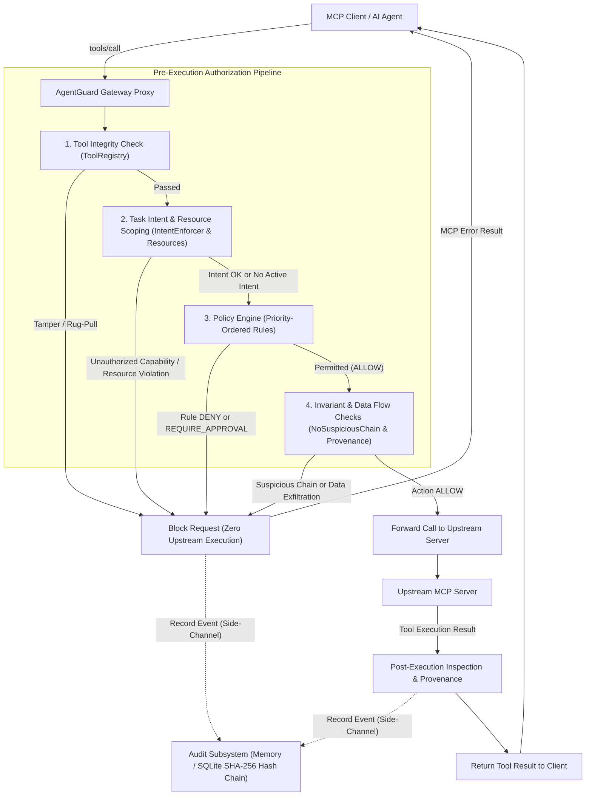

# AgentGuard

A task-aware runtime security gateway and proxy for Model Context Protocol (MCP) tool execution.

[](https://www.python.org/downloads/)
[](LICENSE)
[](#testing-and-security-verification)
[](#testing-and-security-verification)
[](#testing-and-security-verification)

---

## Architecture

AgentGuard operates as a transparent proxy. The AI agent connects to AgentGuard via stdio MCP transport, and AgentGuard spawns and manages the target upstream MCP server.

### Execution Flow



### Component Overview

| Component | Module | Responsibility |
| :--- | :--- | :--- |
| **Gateway Proxy** | `agentguard.gateway.proxy` | Manages MCP protocol sessions, intercepts `tools/list` and `tools/call`, and coordinates the authorization pipeline. |
| **Tool Registry** | `agentguard.integrity.registry` | Inspects upstream tool definitions against registered schemas to detect dynamic mutation ("tool rug-pulls"). |
| **Intent Enforcer** | `agentguard.intent.enforcement` | Enforces least-privilege capability bounds and delegates path/network constraints to resource validators. |
| **Resource Validators** | `agentguard.intent.resources` | Validates file paths (traversal, sensitive files, ADS) and network targets (SSRF, metadata IP, private subnets). |
| **Policy Engine** | `agentguard.policy.engine` | Evaluates priority-ordered declarative rules against tool names and argument patterns. |
| **Invariant Rules** | `agentguard.invariants.rules` | Evaluates multi-step session sequences pre-execution (e.g. `NoSuspiciousChainRule` blocking secret $\rightarrow$ shell $\rightarrow$ network). |
| **Data-Flow Inspector** | `agentguard.dataflow.inspector` | Inspects argument and response payloads for sensitive data patterns (`ToolArgumentInspector`, `ToolResponseInspector`). |
| **Provenance Tracker** | `agentguard.dataflow.provenance` | Tracks data origin, transformation, and destination across tool calls to detect exfiltration paths. |
| **Event Store** | `agentguard.events.store` | Maintains in-memory session history and dispatches sanitized event metadata to the audit repository. |
| **Audit Repository** | `agentguard.audit.repository` | Persists audit events to SQLite with SHA-256 hash chaining and provides cryptographic verification. |

---

## Overview

Modern AI agents rely on tools to interact with their operating environment: reading local files, executing terminal commands, querying APIs, and mutating databases. Granting language models direct, unconstrained access to these capabilities exposes host systems to prompt injection, indirect instruction poisoning, unexpected multi-step tool chains, and data exfiltration.

**AgentGuard** sits as an intermediary runtime security gateway between AI clients (such as Claude Code, Cursor, or custom agent runtimes) and upstream Model Context Protocol ([MCP](https://modelcontextprotocol.io)) servers. Every tool call is intercepted, inspected, and validated against declared task intents, prioritized policy rules, resource boundaries, and behavioral sequence invariants *before* it can reach the upstream tool implementation.

If an operation is unauthorized, AgentGuard rejects the request at the gateway boundary with zero upstream execution, leaving zero dangerous side effects on the underlying host.

---

## Key Features

- **Configurable Policy Engine**: Evaluates prioritized rules (`ToolNameRule`, `ArgumentPatternRule`, `ApprovalRule`) supporting exact matches, substring matching, and regular expressions with deterministic actions (`ALLOW`, `DENY`, `REQUIRE_APPROVAL`).
- **Task-Aware Intent Enforcement**: Constrains active agent sessions to a declared `TaskIntent`, enforcing least privilege across capabilities and resource boundaries.
- **Capability-Based Authorization**: When `TaskIntent` enforcement is active, maps tool requests to abstract capabilities (`FILE_READ`, `FILE_WRITE`, `SHELL`, `NETWORK`, `ENCODING`, `PRIVILEGED`) and denies unmapped or unauthorized capabilities. When no intent is configured, requests fall through to the policy engine, which retains a documented default-allow baseline.
- **Resource Validation**:
  - *Filesystem*: Multi-pass URL decoding, traversal sequence rejection (`../`, `..\`), Windows Alternate Data Stream (ADS) detection, UNC network share blocking, and sensitive pattern protection.
  - *Network / SSRF*: Strict scheme validation (`http`, `https`), private IP range filtering (RFC 1918), cloud metadata blocking (`169.254.169.254`), decimal/hexadecimal/octal IP parsing, IPv4-mapped IPv6 detection, and pre-execution DNS resolution checks.
- **MCP Gateway Proxy Architecture**: Implements the Model Context Protocol over standard input/output (`stdio`), proxying `tools/list` and `tools/call` without requiring upstream server modifications.
- **Tool Integrity and Rug-Pull Detection**: Monitors tool schemas dynamically to detect unauthorized schema mutations or unexpected tool registrations.
- **Tamper-Evident Audit Logging**: Links audit records via SHA-256 hash chains over canonical JSON representations, enabling verifiable detection of payload modifications and intermediate chain breaks.
- **Memory and SQLite Event Stores**: Offers an ephemeral in-memory store for isolated testing and an indexed SQLite repository for persistent auditing.
- **Fail-Closed Evaluation**: Policy evaluation failures, tool integrity errors, or unhandled gateway exceptions immediately reject tool invocation.
- **Deterministic Invariant Checks**: Enforces pre-execution behavioral rules (such as `NoSuspiciousChainRule`) to block multi-step credential theft chains.

---

## Table of Contents

- [Architecture](#architecture)
  - [Execution Flow](#execution-flow)
  - [Component Overview](#component-overview)
- [Overview](#overview)
- [Key Features](#key-features)
- [Why AgentGuard?](#why-agentguard)
- [Security Model](#security-model)
  - [Policy Evaluation and Rule Priorities](#policy-evaluation-and-rule-priorities)
  - [Task Intent and Capability Scoping](#task-intent-and-capability-scoping)
  - [Filesystem Resource Validation](#filesystem-resource-validation)
  - [Network Target Validation and SSRF Defense](#network-target-validation-and-ssrf-defense)
  - [Audit Event Integrity and Data Sanitization](#audit-event-integrity-and-data-sanitization)
  - [Gateway Boundary vs. System Isolation](#gateway-boundary-vs-system-isolation)
- [Installation and Setup](#installation-and-setup)
- [Quick Start](#quick-start)
- [Policy Configuration](#policy-configuration)
  - [JSON Policy Schema](#json-policy-schema)
  - [Rule Types and Fields](#rule-types-and-fields)
- [Audit Logging](#audit-logging)
  - [Storage Backends and Persistence Semantics](#storage-backends-and-persistence-semantics)
  - [CLI Audit Commands](#cli-audit-commands)
- [Testing and Security Verification](#testing-and-security-verification)
  - [Verified Benchmark Metrics](#verified-benchmark-metrics)
  - [Running Tests and Benchmarks](#running-tests-and-benchmarks)
- [Limitations and Threat Model](#limitations-and-threat-model)
- [Roadmap](#roadmap)
- [License and Contributing](#license-and-contributing)

---

## Why AgentGuard?

Traditional security measures for developer tools assume human operators who review commands before running them. Autonomous agents invalidate this assumption:

- **Unrestricted Tool Execution**: Upstream MCP servers often expose powerful operations (shell execution, code compilation, filesystem modification) without fine-grained permission models.
- **Unauthorized Operations**: Agents driven by external inputs can deviate from their intended task scope, invoking tools that have no relevance to the user's objective.
- **Sensitive File Access**: Agents frequently scan directory structures and may inadvertently or adversarially read `.env` secrets, private SSH keys, cloud credentials, or system password hashes.
- **Unsafe Network Destinations**: Unfettered HTTP tools enable Server-Side Request Forgery (SSRF) targeting cloud instance metadata endpoints (`169.254.169.254`), loopback services (`127.0.0.1`), or private subnets.
- **Lack of Auditability**: Standard agent loops lack a tamper-evident, verifiable execution log, making post-incident forensics and compliance verification difficult.

AgentGuard addresses these challenges by enforcing a deterministic, defense-in-depth authorization layer that validates arguments, restricts network/file access, tracks data provenance, and cryptographically hash-chains every event for forensic verification.

---

## Security Model

AgentGuard applies defense-in-depth principles through deterministic runtime checks.

### Policy Evaluation and Rule Priorities

The policy engine evaluates rules in descending order of their integer `priority` field:

1. **Higher Priority Wins**: A rule with `priority: 100` is evaluated before a rule with `priority: 50`.
2. **First Match Decides**: The first rule whose condition matches the incoming `ToolRequest` determines the decision (`DENY`, `REQUIRE_APPROVAL`, or `ALLOW`).
3. **Declaration Order Tie-Breaker**: When multiple rules share identical priorities, they are evaluated in the order they were loaded.
4. **Default-Allow Baseline**: If no intent rule applies and no policy rule matches, the policy engine defaults to `ALLOW` (`RiskLevel.LOW`). AgentGuard does **not** enforce an unconditional deny-by-default baseline across the entire gateway unless an operator configures an active restrictive `TaskIntent` or adds explicit catch-all deny rules.

### Task Intent and Capability Scoping

When a `SecurityContext` contains an active `TaskIntent`, intent enforcement runs before the general policy engine:
- The invoked tool is mapped to an abstract `Capability` (`FILE_READ`, `FILE_WRITE`, `SHELL`, `NETWORK`, `ENCODING`, `PRIVILEGED`).
- If intent enforcement is active and the tool cannot be mapped to a known capability, it is denied by default (`intent-unknown-capability-block`).
- If intent enforcement is active and the capability is not listed in `allowed_capabilities`, execution is denied (`intent-unauthorized-capability-block`).
- If resource constraints are specified, arguments are validated against allowed directories or hosts. An exact resource match grants an explicit `ALLOW`; generalized paths proceed to policy engine evaluation.
- When no `TaskIntent` is configured or active, capability checks are bypassed, and tool requests fall through directly to the Policy Engine.

### Filesystem Resource Validation

Path arguments (`path`, `filename`, `file`, `filepath`, `dir`, `directory`, `source`, `dest`, `target`) undergo deterministic sanitization via `validate_file_read`:
1. **Iterative Percent-Decoding**: Decodes up to 5 passes to neutralize nested URL-encoding evasions (`%252e%252e%252f`).
2. **Traversal Check**: Explicitly detects `../`, `..\`, `/..`, and trailing `..` segments before path resolution.
3. **UNC / Network Share Block**: Denies paths starting with `\\` or `//` to prevent OS-level SMB connections and NTLM hash theft.
4. **Windows ADS Protection**: Blocks Windows Alternate Data Streams (`filename:stream` or `::$DATA`).
5. **Canonical Path Resolution**: Resolves paths to absolute canonical forms using `pathlib.Path.resolve()`.
6. **Sensitive Pattern Deny List**: Denies access if the canonical path contains patterns such as `/.env`, `/.git`, `/.ssh`, `/id_rsa`, `/id_ed25519`, `/id_ecdsa`, `/passwd`, `/shadow`, or `/credentials.json`.
7. **Workspace Scoping**: Ensures the resolved path resides within the configured list of allowed workspace roots.

### Network Target Validation and SSRF Defense

Network arguments (`url`, `uri`, `endpoint`, `address`, `host`, `target`) are validated via `validate_network`:
1. **Protocol Restriction**: Permits only `http` and `https` schemes; denies `file://`, `gopher://`, `ftp://`, or custom schemes.
2. **Hostname Validation**: Rejects empty hostnames, `localhost`, and internal domain suffixes (`.local`, `.internal`, `.lan`, `.localhost`).
3. **IP Representation Parsing**: Parses standard dotted-decimal IPs, decimal integers (`2130706433`), hexadecimal integers (`0x7f000001`), octal representations, and IPv4-mapped IPv6 addresses (`::ffff:127.0.0.1`).
4. **Restricted IP Ranges**: Denies loopback (`127.0.0.0/8`, `::1`), link-local / cloud metadata (`169.254.169.254`), private networks (RFC 1918: `10.0.0.0/8`, `172.16.0.0/12`, `192.168.0.0/16`), unspecified addresses (`0.0.0.0`), multicast, and non-global addresses.
5. **DNS Pre-Resolution**: Performs socket DNS lookups on non-IP hostnames prior to execution, blocking domains that resolve to private or metadata addresses.
6. **Allowed Hosts**: When an `allowed_hosts` list is provided, restricts traffic strictly to authorized domains.

### Audit Event Integrity and Data Sanitization

AgentGuard records all tool execution attempts:
- **Argument Sanitization**: Raw argument values are sanitized prior to persistence (`sanitize_arguments`). The audit store preserves keys, types, and lengths (e.g. `{"password": "<str, len=24>"}`) without storing raw secret payloads.
- **Cryptographic Hash Chaining**: Every `AuditEvent` generates an `event_hash` via SHA-256 over a canonical, sorted JSON serialization of its fields. Each record includes the `previous_event_hash` of the prior session event, forming a linked chain.
- **Tamper-Evident Detection**: The verification tool recalculates event hashes and validates chain linkage (`previous_event_hash` $\rightarrow$ `event_hash`). Modifying recorded fields or deleting an intermediate event breaks the chain and is detected during verification.
- **Tail Truncation Qualification**: Because the hash chain links each event backward to its predecessor, deleting one or more events from the *tail* of a session (the most recent records) leaves the remaining historical chain internally valid. Detecting tail truncation requires comparing against an independently trusted checkpoint, external event counter, or externally published chain head.
- **Privileged Rewriting Limitation**: The hash chain is **tamper-evident, not tamper-proof** against a root host attacker with direct SQLite write access who can alter historical records and recompute all subsequent SHA-256 hashes without external WORM or remote KMS attestation.
- **Side-Channel Isolation**: Audit persistence operates independently of policy enforcement. A failure in the audit database does not block or delay critical security decisions.

### Gateway Boundary vs. System Isolation

> [!IMPORTANT]
> AgentGuard is an **application-layer gateway**, not an operating system sandbox or network hypervisor. It inspects and polices tool requests at the MCP transport layer before forwarding them.
>
> Defense-in-depth requires pairing AgentGuard with OS-level isolation (containers, seccomp, AppArmor, network namespaces) to protect against threats outside the gateway's boundary.

---

## Installation and Setup

AgentGuard requires **Python 3.12 or higher**.

### Using `uv` (Recommended)

```bash
# Clone repository
git clone https://github.com/KartavyaChauhan/AgentGuard.git
cd AgentGuard

# Sync dependencies and create virtual environment
uv sync

# Verify installation
uv run agentguard --version
```

### Using Standard `pip`

```bash
git clone https://github.com/KartavyaChauhan/AgentGuard.git
cd AgentGuard

python -m venv .venv
source .venv/bin/activate  # On Windows: .venv\Scripts\activate

pip install -e ".[dev]"
agentguard --version
```

---

## Quick Start

This walkthrough sets up AgentGuard as a security proxy in front of an upstream MCP server.

### 1. Define a Policy File (`policies.json`)

Create a custom policy file defining the authorization rules:

```json
{
  "rules": [
    {
      "type": "argument_pattern",
      "id": "block-env-access",
      "description": "Block attempts to read sensitive environment files",
      "tool_name": "read_file",
      "argument": "path",
      "pattern": ".env",
      "priority": 100,
      "action": "DENY",
      "risk_level": "HIGH"
    },
    {
      "type": "tool_name",
      "id": "block-sudo",
      "description": "Prevent privileged execution via sudo",
      "tool_name": "sudo",
      "priority": 100,
      "action": "DENY",
      "risk_level": "CRITICAL"
    },
    {
      "type": "approval",
      "id": "approve-destructive-git",
      "description": "Require operator approval before force pushing",
      "tool_name": "git_push_force",
      "priority": 50,
      "action": "REQUIRE_APPROVAL",
      "risk_level": "HIGH"
    }
  ]
}
```

### 2. Configure Gateway Settings (`gateway.json`)

Define the upstream command and storage backend:

```json
{
  "upstream": "python -m my_mcp_server",
  "policies": "policies.json",
  "event_store": "sqlite"
}
```

### 3. Launch the Gateway

Start the gateway via configuration file:

```bash
uv run agentguard gateway --config gateway.json
```

Or pass settings directly via CLI flags:

```bash
uv run agentguard gateway \
  --upstream "python -m my_mcp_server" \
  --policy policies.json
```

The gateway listens on `stdio`, ready to accept MCP client connections, while proxying authorized calls to `python -m my_mcp_server`.

---

## Policy Configuration

AgentGuard supports loading policy rules from the built-in reference set (`default`) or from custom JSON files.

### JSON Policy Schema

A valid policy document must have an object root with a `"rules"` array:

```json
{
  "rules": [
    {
      "type": "argument_pattern",
      "id": "deny-destructive-rm",
      "description": "Prevent rm -rf commands",
      "tool_name": "shell",
      "argument": "command",
      "pattern": "rm -rf",
      "is_regex": false,
      "priority": 100,
      "action": "DENY",
      "risk_level": "CRITICAL"
    },
    {
      "type": "argument_pattern",
      "id": "deny-aws-credentials",
      "description": "Prevent access to AWS credentials via regex",
      "tool_name": "read_file",
      "argument": "path",
      "pattern": "^.*aws/credentials.*$",
      "is_regex": true,
      "priority": 90,
      "action": "DENY",
      "risk_level": "HIGH"
    },
    {
      "type": "tool_name",
      "id": "deny-raw-socket",
      "description": "Block low-level network socket creation",
      "tool_name": "create_socket",
      "priority": 80,
      "action": "DENY",
      "risk_level": "HIGH"
    },
    {
      "type": "approval",
      "id": "require-deploy-approval",
      "description": "Require confirmation for production deployments",
      "tool_name": "deploy_prod",
      "priority": 50,
      "action": "REQUIRE_APPROVAL",
      "risk_level": "MEDIUM"
    }
  ]
}
```

### Rule Types and Fields

| Rule Type | Required Fields | Optional Fields | Notes |
| :--- | :--- | :--- | :--- |
| `tool_name` | `type`, `id`, `description`, `tool_name` | `priority` (default `0`), `action` (default `DENY`), `risk_level` (default `HIGH`) | Matches exact tool name. |
| `argument_pattern` | `type`, `id`, `description`, `argument`, `pattern` | `tool_name` (default `""`), `is_regex` (default `false`), `priority` (default `0`), `action` (default `DENY`), `risk_level` (default `HIGH`) | Matches an argument string via substring or regex. If `tool_name` is empty, matches across all tools. |
| `approval` | `type`, `id`, `description`, `tool_name` | `priority` (default `0`), `action` (must be `REQUIRE_APPROVAL`), `risk_level` (default `MEDIUM`) | Returns `REQUIRE_APPROVAL` when the specified tool is invoked. |

Unknown fields within a rule object cause `PolicyConfigurationError` to prevent misconfigurations from silently passing.

---

## Audit Logging

AgentGuard supports both ephemeral and persistent audit recording.

### Storage Backends and Persistence Semantics

1. **In-Memory Store (`memory`)**: Tracks session history in memory. Useful for ephemeral CLI runs, automated tests, and stateless agent containers.
2. **SQLite Repository (`sqlite`)**: Persists events to an SQLite database (default: `audit.sqlite3`, or specified via the `AGENTGUARD_AUDIT_DB` environment variable).
   - Indexed on `session_id`, `timestamp`, `tool_name`, `event_type`, and `event_hash`.
   - Arguments are scrubbed to preserve metadata without leaking credentials.
   - Events are linked via SHA-256 hash chains (`previous_event_hash` → `event_hash`).

> [!WARNING]
> **Persistence Isolation & Volatility**: Because audit persistence executes in a non-blocking side-channel, if the SQLite persistence layer encounters an error (e.g. disk exhaustion, permissions failure, or database locking), events remain in the in-memory event store for the process duration, but will **not** be durably written to SQLite. Policy enforcement continues unaffected, but durable audit records for those events may be lost upon process termination.

### CLI Audit Commands

AgentGuard provides a built-in suite of commands to inspect and verify audit databases:

```bash
# View database summary (event count, session count, overall chain integrity)
uv run agentguard audit

# List all recorded sessions with event counts and timestamps
uv run agentguard audit sessions

# Inspect full event sequence for a specific session
uv run agentguard audit session <session_id>

# Cryptographically verify SHA-256 hash-chain continuity across all sessions
uv run agentguard audit verify

# Verify hash chain for a specific session
uv run agentguard audit verify --session <session_id>

# Run the automated audit tampering and isolation benchmark (10 test cases)
uv run agentguard audit attack
```

All audit commands support the `--json` flag for machine-readable output in CI/CD pipelines.

---

## Testing and Security Verification

AgentGuard includes a comprehensive test suite and synthetic adversarial benchmarks.

### Verified Benchmark Metrics

The following metrics reflect verified local test executions:

| Metric | Result | Description |
| :--- | :---: | :--- |
| **Unit & Integration Suite** | **729 passed** | Unit, integration, and gateway tests (`pytest`). |
| **Statement Coverage** | **89%** | Evaluated across 4,333 statements (`pytest-cov`). |
| **Adversarial Authorization** | **45 / 45 blocked** | Direct path traversal, encoded paths, SSRF, and command injection tests. |
| **Red-Team Evasion Suite** | **12 handled** | **10 prevented** before execution (zero side effects); **2 detected** post-execution (repeated-failure loop and tool poisoning). |
| **Audit Tamper Benchmark** | **10 / 10 detected** | Validates detection of modified timestamps, payload alterations, and intermediate event deletions. |
| **Dangerous Side Effects** | **0** | Blocked calls produce zero upstream executions. |
| **Unified Security Gate** | **PASS** | Automated gate enforcing all invariant suites. |

> [!NOTE]
> These metrics reflect verified test results from internal regression suites in this repository. They demonstrate concrete defensive capabilities against modeled threat vectors, but do not imply a guarantee against novel zero-day vulnerabilities.

### Running Tests and Benchmarks

```bash
# Run the test suite
uv run pytest -q

# Run with test coverage report
uv run pytest --cov=agentguard

# Run the unified security regression gate
uv run agentguard security-gate

# Run individual benchmarks
uv run agentguard adversarial       # 45-case adversarial authorization benchmark
uv run agentguard redteam           # 12-scenario red-team evasion suite
uv run agentguard audit attack      # 10-case tamper detection benchmark
uv run agentguard demo              # Interactive scenario walkthrough
```

---

## Limitations and Threat Model

A clear understanding of boundaries is critical for secure system design.

| Threat Vector | AgentGuard Gateway Scope | Operating System / Infrastructure Requirement |
| :--- | :--- | :--- |
| **Path Traversal / Secret Files** | Denies traversal sequences, ADS streams, and known secret filenames (`.env`, `.ssh`). | Requires container filesystem isolation (chroot, read-only mounts) to eliminate symlink TOCTOU race conditions. |
| **SSRF / Cloud Metadata** | Blocks cloud metadata IP (`169.254.169.254`), loopback, private subnets, and resolves hostnames before execution. | Requires host firewall egress filtering (iptables / eBPF / AWS IMDSv2 hop limits) to prevent DNS rebinding or HTTP redirect-based SSRF in upstream tools. |
| **Audit Record Modification & Truncation** | Detects payload alterations and intermediate record deletions via broken SHA-256 chain links. | Tail truncation (deleting recent events from the end of a session) cannot be detected without an external checkpoint or counter. Furthermore, a root host attacker with SQLite write access can rewrite the database and recompute hashes; remote append-only log shipping (SIEM/WORM) is required for non-repudiation. |
| **Audit Persistence Failures** | Records events in memory; non-blocking side-channel ensures enforcement continues uninterrupted. | If SQLite writes fail (e.g. disk full, permission error), events remain in volatile memory and are not durably saved to disk. |
| **Tool Execution Side Effects** | Prevents unauthorized tools from reaching the upstream server. | If a tool call is authorized (`ALLOW`), side effects inside the tool execution depend on upstream sandboxing. |
| **Unconfigured Policies** | Defaults to `ALLOW` if no intent or policy rule matches. | Operators must configure explicit policy rules or declare strict `TaskIntent` contracts for zero-trust containment. |

---

## Roadmap

Planned capabilities and future enhancements:

- [ ] **Remote Append-Only Audit Streaming**: Native export of audit events to remote SIEM targets, OpenTelemetry collectors, or cloud object storage with Object Lock (WORM).
- [ ] **Interactive Operator Approvals**: Pluggable callback hooks and terminal UI prompts for resolving `REQUIRE_APPROVAL` actions in real time.
- [ ] **Container & Egress Enforcement Hooks**: Integration with eBPF or container network namespaces to enforce redirect and DNS rebinding protections at the socket layer.
- [ ] **YAML / TOML Policy Support**: Support for alternative policy definition formats alongside the existing JSON loader.

---

## License and Contributing

### License

AgentGuard is licensed under the **MIT License**. See the [LICENSE](LICENSE) file for details.

```text
Copyright (c) 2026 AgentGuard Contributors
```

### Security Disclosures

If you discover a security vulnerability within AgentGuard, please do **not** open a public issue. Review our [SECURITY.md](SECURITY.md) for responsible disclosure guidelines via GitHub Private Vulnerability Reporting.
